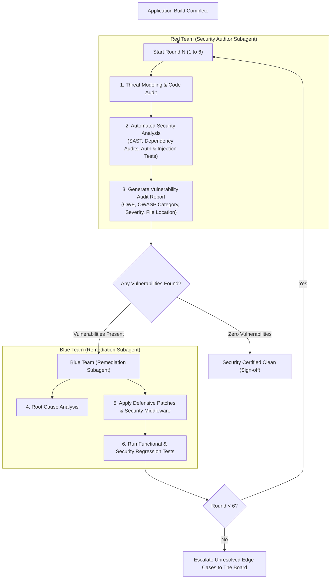

# Workflow: Red Team / Blue Team Security Hardening Loop

This workflow governs the post-build automated security audit and remediation cycle. It pits a **Red Team (Security Auditor)** against a **Blue Team (Remediation Engineer)** in up to 6 iterative rounds to detect, report, patch, and verify all codebase vulnerabilities.

---

## 1. The Red/Blue Team Iterative Cycle



---

## 2. Red Team (Auditor) Assessment Matrix

The Red Team audits the codebase against real-world vulnerability classes:

1. **Authentication & Session Flaws (OWASP A07):**
   * Missing expiration on JWTs or session tokens.
   * Weak password policy enforcement.
   * Session fixation or improper logout revocation.
2. **Broken Authorization & IDOR (OWASP A01):**
   * User A accessing User B's cart, shipping address, or order history via URL ID tampering.
   * Unprotected admin or internal metrics endpoints.
3. **Injection Vectors (OWASP A03):**
   * Unescaped database queries or unsanitized user inputs in product search and reviews.
   * Cross-Site Scripting (XSS) risks in user-rendered comments or profile fields.
4. **Security Misconfigurations (OWASP A05):**
   * Overly permissive CORS policies (e.g. `Access-Control-Allow-Origin: *` with credentials).
   * Missing Content-Security-Policy (CSP), HSTS, or clickjacking (`X-Frame-Options`) headers.
   * Debug flags or stack traces exposed in API error responses.
5. **Data Privacy & Leakage (DPDP Act 2023 & GDPR):**
   * Sensitive personal data (passwords, card tokens, phone numbers) exposed in server logs.
   * Missing cookie consent enforcement prior to firing analytics scripts.
   * Unimplemented or non-functional data erasure endpoints.
6. **Rate Limiting & Abuse (OWASP A04):**
   * Missing rate limits on login, OTP, registration, or coupon-redemption routes.

---

## 3. Vulnerability Audit Report Format

The Red Team outputs an inspectable vulnerability report:

```markdown
════════════════════════════════════════════════════════════════
SECURITY VULNERABILITY AUDIT REPORT — ROUND [N/6]
════════════════════════════════════════════════════════════════
Status: VULNERABILITIES DETECTED
Findings Count: [X Critical, Y High, Z Medium, W Low]

### Finding 1: Broken Object Level Authorization (IDOR) on Orders
- Severity: HIGH
- OWASP Category: A01:2021-Broken Access Control
- CWE: CWE-639 (Authorization Bypass Through User-Controlled Key)
- Affected File: `src/server/routes/order.routes.ts:42`
- Vulnerability Description:
  The route `GET /api/orders/:orderId` fetches the order directly by ID
  without verifying that `order.userId === req.user.id`.
- Recommended Defensive Fix:
  Add an ownership verification check in the order controller before returning records.

### Finding 2: Missing Rate Limiting on Checkout
- Severity: MEDIUM
- OWASP Category: A04:2021-Insecure Design
- Affected File: `src/server/routes/checkout.routes.ts:18`
- Recommended Defensive Fix:
  Attach the rate limiting middleware `checkoutRateLimiter` to the checkout POST endpoint.
════════════════════════════════════════════════════════════════
```

---

## 4. Blue Team (Remediation) Protocol

1. **Intake Report:** The Blue Team reads each finding in the audit report.
2. **Defensive Patching:**
   * Patches the source code files to eliminate the root vulnerability.
   * Strengthens input validation, middleware, authorization checks, and security headers.
   * Never weakens test assertions or deletes security guards to pass audits.
3. **Automated Verification:**
   * Runs the full unit, integration, and security test suites to verify that the patch fixes the vulnerability without breaking existing features.
4. **Handoff to Next Round:**
   * Passes the patched codebase back to the Red Team for the next audit round.

---

## 5. Termination & Exit Conditions

* **Clean Exit (Success):** If the Red Team conducts a full scan and finds **0 Critical, 0 High, 0 Medium, and 0 Low** vulnerabilities, the loop concludes immediately (even before Round 6), marking the application **Security Certified**.
* **Round Ceiling (Max 6 Rounds):** If vulnerabilities remain after 6 rounds, the orchestrator generates a detailed security exception report for "The Board" (the user) highlighting the exact remaining risks for review.
